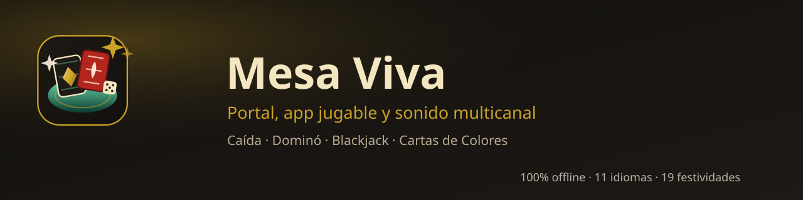

# Mesa Viva Ultimate



[](https://github.com/emanuelindustri-source/mesa-viva-ultimate/actions/workflows/ci.yml)

Plataforma multiplataforma de juegos de cartas y juegos de mesa con motor 2.5D,
modo offline, multijugador híbrido y monetización compatible con Google Play.

**Estado actual:** Fase 6 — Reconstrucción Visual de Estudio y Ajedrez entregada
(v0.8.0). Portal `/`, app jugable `/play/` a 100dvh, salón de club procedural,
mesa ovalada 2.5D, arrastre táctil infalible, historial lateral, sala persistente,
chat con emojis y cinco juegos: Caída, Dominó, Blackjack, Colores y Ajedrez de
Club. PWA offline-first, 19 festividades × claro/oscuro y monetización con
límites de frecuencia.

## Identidad visual y experiencia

- `BrandAssetGenerator`: logo mutante por festividad, emblemas por juego, favicon,
  iconos Android/Material You, splash screens y banner del repositorio.
- Modo claro, oscuro y automático del sistema combinado con Material You,
  paletas propias y las 19 festividades + Día Normal.
- `GameVFXController`: chispas doradas en la Caída, ondas de madera en el Dominó,
  estelas neón en Colores y lluvia de fichas en Blackjack.
- Portal `/` con historia, galería interactiva de reglas, historial real de
  versiones, descarga Android y acceso directo a la mesa.
- App `/play/` con perfil, XP, rangos, Fichas de Mesa firmadas con HMAC, racha,
  misiones, tienda, bots de tres niveles y modo Pasa y Juega.
- Salón híbrido sobre WebRTC/PeerJS con PIN de 6 dígitos, QR, chat y cambio de
  juego sin salir de la sala.
- PWA con precache completo y aviso elegante de actualización; `app-ads.txt`,
  `/privacy`, `/terms` y consentimiento UMP listos para Android.

## Estructura

| Ruta | Contenido |
| --- | --- |
| `packages/core` | Motor universal de reglas, catálogo, bots y economía |
| `packages/design-system` | Material You, festividades, formatos de pantalla y atlas vectorial |
| `packages/engine-25d` | Motor gráfico PixiJS v8 + GSAP, entidades y sensores |
| `packages/sensory-engine` | Audio espacial, música adaptativa, háptica y sensores |
| `apps/client` | Portal web `/`, app jugable `/play/` y proyecto Capacitor |
| `docs/versiones` | Notas de versión cronológicas y próxima versión |

## Motor 2.5D

- Punto de entrada puro `@mesa-viva/engine-25d` para Node, CI y reglas.
- Runtime gráfico en `@mesa-viva/engine-25d/pixi` para navegador con WebGL.
- `TableStage` adapta cámara, área segura y paneles a móvil, tablet, televisor,
  laptop, ultrawide y plegable.
- Cartas, fichas, dados, peones, pilas de fichas y asientos con pooling.
- Atlas temático rasterizado desde SVG, sin imágenes externas.
- `MotionSensorEngine` con giroscopio, agitado, boca abajo y watchdog seguro.

## Motor sensorial

- `AudioRuntime` perezoso a 48 kHz: el navegador no crea audio hasta un gesto.
- `MultiChannelRouter` binaural 2.0, 2.1, 5.1/5.2 y 7.1 con canales discretos,
  LFE dedicado y degradación segura.
- `StudioMasterBus` con reverb de sala de madera y limitador brickwall −1 dBFS.
- Voz tarareando con formantes /m/, /u/, /o/, portamento y vibrato progresivo.
- Rhodes, cuatro Karplus, contrabajo LFE, marimba, cuerdas, percusión y beatbox.
- Compositor de 32–64 compases con motivos, modulación, pregunta/respuesta y
  adaptación a concentración, energía y clímax.
- 19 festividades + Día Normal y SFX armónicos afinados al acorde activo.
- Laboratorio multicanal interactivo en el portal.

## Comandos

```powershell
pnpm install     # instalar dependencias
pnpm build       # compilar todos los paquetes
pnpm test        # pruebas automáticas con Vitest
pnpm typecheck   # verificación de tipos
pnpm lint        # reglas y estilo con Biome
pnpm dev         # cliente en desarrollo (desde apps/client)
```

## Enlaces

- Portal: https://emanuelindustri-source.github.io/mesa-viva-ultimate/
- Repositorio: https://github.com/emanuelindustri-source/mesa-viva-ultimate

Las fichas de Mesa Viva son virtuales y no tienen valor monetario. No hay apuestas
ni premios reales.
